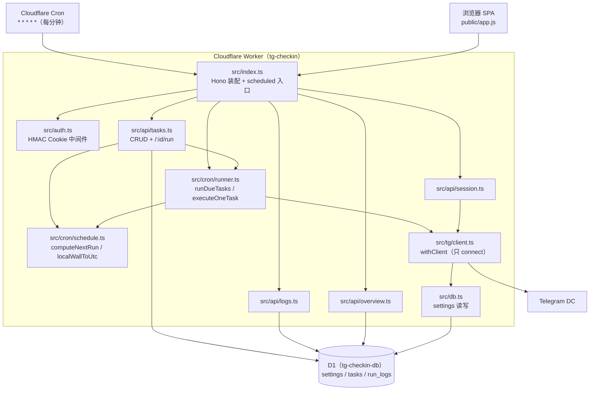
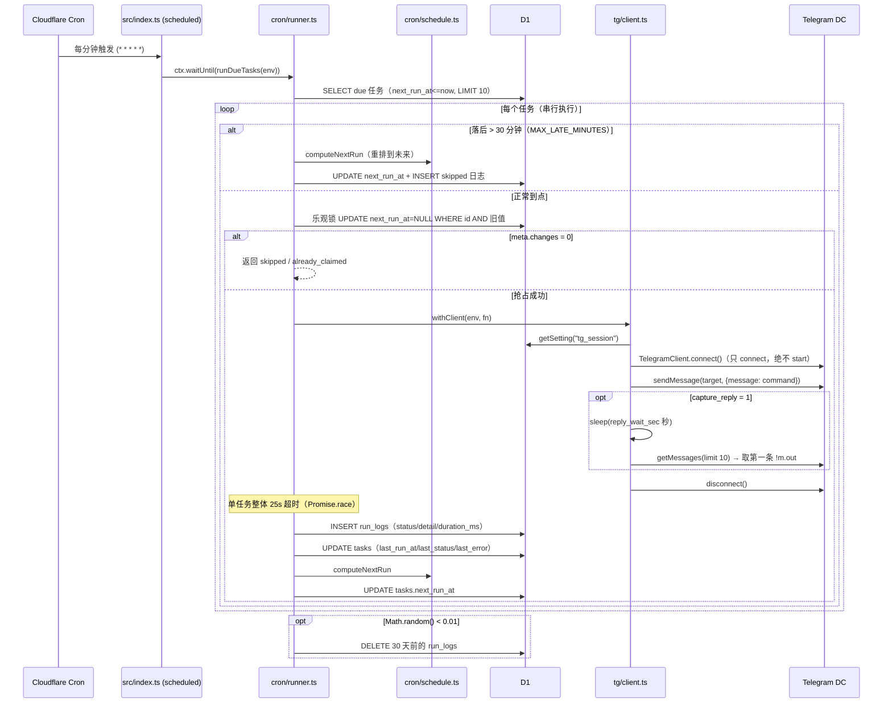
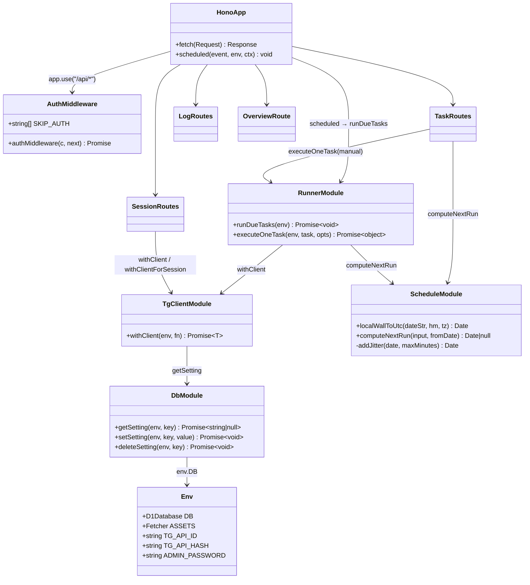

# cf-tg-checkin 项目全量代码分析与维护建议报告

- **分析人**：software-architect（架构师）
- **日期**：2026-10-24
- **分析对象**：`C:/Users/Administrator/agents/workbuddy/cf-tg-checkin`（git HEAD: `bd9cdc1`，共 2 个提交）
- **分析方式**：对仓库受版本管理的 25 个文件逐一实际通读（含 package-lock.json 关键版本提取、git log）；纯只读分析，未改动任何项目文件。`node_modules` 未安装，故未实际执行 typecheck/test，相关结论依据代码与 AGENT_HANDOFF.md 自述，并标注"待验证"。

---

## 0. 结论速览

这是一个**完成度高、文档齐全、架构纪律执行到位**的小型 Serverless 应用：M0–M6 全部完成并已上线（AGENT_HANDOFF.md §0），代码与 PLAN/AGENT_TASK 的关键决策高度一致（单 cron 扫表调度、只 `connect()` 不 `start()`、session 不返回前端、时区换算自实现、SQL 全部参数绑定均已落实）。

最需要关注的 3 个问题（详见 §3）：

1. **[高·稳定性] 任务"占位后崩溃即永久停跑"**：runner 乐观锁把 `next_run_at` 置 NULL 后，到重排之前没有任何 try/finally 保护，中间任一环异常都会让该任务永远不再被选中，且无告警（src/cron/runner.ts:80-86 ↔ 149-163）。
2. **[高·安全] 登录接口无速率限制且密码比对非恒定时间**：src/index.ts:16-20，偏离 AGENT_TASK.md:200 的既定规格；仓库公开 + 线上 URL 公开，可被暴力破解。
3. **[中·稳定性] 25 秒超时定时器未清除**：src/cron/runner.ts:93-95，正常路径下 25 秒后必然产生一次 unhandled rejection。

另有两处本地工程化断层：`.npmrc` 硬编码本机代理（换机即装不了依赖）、`_run.bat` 指向已废弃的旧路径。

---

## 1. 项目全景

### 1.1 目录结构与文件职责

```
tg-checkin-serverless/
├── wrangler.toml            # Worker 配置：nodejs_compat、D1 绑定、每分钟 cron、静态 assets
├── package.json             # 依赖与脚本（实际用 npm）
├── package-lock.json        # npm lockfile（lockfileVersion 3，232 个包）
├── tsconfig.json            # TS strict + workers-types + bundler 解析；排除 tests
├── vitest.config.ts         # vitest 仅收录 tests/**/*.test.ts
├── .npmrc                   # npm 走 127.0.0.1:7897 代理 + 本地缓存
├── .gitignore               # node_modules / .dev.vars / .wrangler / .tg_code.txt 等
├── .dev.vars.example        # 本地密钥模板（TG_API_ID / TG_API_HASH / ADMIN_PASSWORD）
├── migrations/
│   └── 0001_init.sql        # 三张表 DDL：settings / tasks / run_logs
├── scripts/
│   └── login.mjs            # 本地非交互登录脚本 → 产出 StringSession
├── src/
│   ├── index.ts             # Hono 装配 + fetch/scheduled 双入口
│   ├── bindings.ts          # Env 类型（DB/ASSETS/3 个密钥）
│   ├── auth.ts              # HMAC Cookie 鉴权中间件
│   ├── db.ts                # settings 表读写封装
│   ├── tg/client.ts         # withClient()：读 session→connect→fn→disconnect
│   ├── cron/
│   │   ├── schedule.ts      # computeNextRun() + localWallToUtc()（时区换算核心）
│   │   └── runner.ts        # runDueTasks() + executeOneTask()（执行编排核心）
│   └── api/
│       ├── tasks.ts         # 任务 CRUD + /:id/run 立即执行
│       ├── logs.ts          # 执行日志查询（游标分页）
│       ├── session.ts       # Session 状态/保存/清除
│       └── overview.ts      # 仪表盘聚合数据
├── public/                  # 原生 SPA（零构建）
│   ├── index.html           # 入口 HTML（#app-root 容器）
│   ├── app.js               # hash 路由 SPA 全部逻辑（437 行）
│   └── style.css            # 暗色卡片主题（54 行）
├── tests/
│   └── schedule.test.ts     # schedule.ts 的 10 个单测
├── README.md                # 人类用户简版文档
├── PLAN.md                  # 原始完整技术方案（设计权威来源）
├── AGENT_TASK.md            # 里程碑任务书（M0–M7 + 全局上下文/红线）
├── AGENT_HANDOFF.md         # 交接文档（现状/数据模型/已知坑/红线）
└── _run.bat                 # Windows 带代理执行命令的辅助脚本（路径已失效，见 E2）
```

### 1.2 技术栈（依据 package.json / package-lock.json / wrangler.toml 实际内容）

| 层 | 选型 | 实测版本 | 依据 |
|---|---|---|---|
| 运行时 | Cloudflare Workers + `nodejs_compat` | compatibility_date = 2025-04-01 | wrangler.toml:3-4 |
| Web 框架 | Hono | **4.13.9** | package-lock.json |
| Telegram | GramJS（npm 包名 `telegram`） | **2.26.22** | package-lock.json |
| 数据库 | Cloudflare D1（SQLite） | binding=DB，库名 tg-checkin-db | wrangler.toml:15-18 |
| 前端 | 原生 HTML/JS/CSS SPA（零构建、hash 路由） | — | public/ |
| 测试 | Vitest | **5.0.2** | package-lock.json |
| 类型 | TypeScript（strict）+ @cloudflare/workers-types | **7.0.2** / **5.20260927.1** | package-lock.json |
| 部署 | Wrangler CLI | **4.141.0** | package-lock.json |
| 包管理 | npm（lockfileVersion 3，共 232 个包） | — | package-lock.json |

注意事项：
- package.json:17 的 devDependencies 残留 `pnpm@^12.6.0`（实测安装值 12.6.0），但项目实际使用 npm（AGENT_HANDOFF.md:27 明确"沿用 npm，不用 pnpm"），该依赖无用且拖慢安装（见 Q5）。
- optionalDependencies 固定 `@esbuild/win32-x64@^0.28.2`（Windows 平台适配）。
- tsconfig.json:8 `strict: true`，但 `exclude` 含 `tests`（tsconfig.json:18）——测试代码不受类型检查。
- Node 版本要求：README.md:23 注明 ≥ 22（配合 `node --env-file`）。

### 1.3 核心模块划分与调用关系



依赖方向清晰：`api/*` 与 `cron/*` 是两个并列入口面，共用 `tg/client.ts`、`db.ts`、`cron/schedule.ts`；`tasks.ts` 同时依赖 `runner.ts`（立即执行复用单任务执行函数，src/api/tasks.ts:4,127），是全项目唯一的"API→cron"反向依赖点。

### 1.4 入口文件与关键导出

- **src/index.ts:48-57** —— Worker 双入口：`fetch: app.fetch` + `async scheduled(event, env, ctx)`；scheduled 用 `ctx.waitUntil(runDueTasks(env))` 并 catch 兜底（src/index.ts:50-56）。
- **路由装配顺序**（Hono 按注册顺序匹配，`app.use` 中间件只作用于其后注册的路由）：
  1. `GET /api/health`（无鉴权，src/index.ts:13）
  2. `POST /api/login`、`POST /api/logout`（src/index.ts:16-34）
  3. `app.use("/api/*", authMiddleware)`（src/index.ts:37）→ 其后注册的 `/api/session`、`/api/tasks`、`/api/logs`、`/api/overview` 全部受保护
  4. `app.get("*")` 静态回退 `c.env.ASSETS.fetch(c.req.raw)`（src/index.ts:46，必须在所有 /api 路由之后）
- 注意 src/auth.ts:5 的 `SKIP_AUTH` 白名单在当前注册顺序下是**冗余防御**（login/logout/health 注册在中间件之前，根本不会经过中间件），但可防止未来调整注册顺序时误保护，建议保留并加注释说明。
- **scripts/login.mjs** —— 独立 Node 脚本（非 Worker 入口），负责本地登录产出 StringSession；非交互模式：读 `TG_PHONE`/`TG_2FA` 环境变量、轮询 `.tg_code.txt` 文件取验证码、SOCKS5 代理默认 127.0.0.1:7897（scripts/login.mjs:18-50）。

### 1.5 配置项清单

**wrangler.toml**：
- `name = "tg-checkin"`、`main = "src/index.ts"`、`compatibility_date = "2025-04-01"`、`compatibility_flags = ["nodejs_compat"]`（GramJS 依赖 Buffer 与 node:net，必须保留）
- `[triggers] crons = ["* * * * *"]`（每分钟；免费版全账户限 5 个 cron，仅用 1 个）
- `[assets] directory = "./public"`、`binding = "ASSETS"`、`run_worker_first = ["/api/*"]`（防止 SPA 回退拦截 API，AGENT_HANDOFF.md:296 记录的坑）
- `[[d1_databases]] binding = "DB"`、`database_name = "tg-checkin-db"`、`database_id = "5965162f-0f03-4f75-875f-7e3724cb7e2a"`（已提交进公开仓库；database_id 非密钥，但属暴露面信息，见 S8）

**环境变量 / Secrets**（src/bindings.ts:1-7）：
- `TG_API_ID`、`TG_API_HASH`、`ADMIN_PASSWORD` —— 本地放 `.dev.vars`（已被 .gitignore:2 忽略，本次分析环境中确认不存在该文件），线上用 `wrangler secret put`（README.md:55-57）
- `.dev.vars.example` 只含上述三项；`scripts/login.mjs` 另读 `TG_PHONE` / `TG_2FA` / `TG_CODE_FILE` / `TG_PROXY_HOST` / `TG_PROXY_PORT`（仅本地登录用，不进 Worker）

**npm scripts**（package.json:6-14）：`dev` / `deploy` / `db:create` / `db:migrate:local` / `db:migrate:remote` / `typecheck` / `test`。

### 1.6 部署方式

- 代码部署：`npm run deploy` → `wrangler deploy`（package.json:8）
- 数据库：`wrangler d1 create tg-checkin-db` → database_id 填回 wrangler.toml → `wrangler d1 migrations apply --remote`；当前仅 `migrations/0001_init.sql` 一个迁移，无 down 迁移
- 密钥：`wrangler secret put TG_API_ID / TG_API_HASH / ADMIN_PASSWORD`（README.md:55-57）
- Session 上线：本地 `node --env-file=.dev.vars scripts/login.mjs` 登录 → 打印 `SESSION=...` → 管理界面设置页粘贴 → `PUT /api/session`（Worker 先 connect+getMe 验证再入库，src/api/session.ts:44-46）
- 线上 cron 不能手动触发，需等真实整分钟（README.md:61、AGENT_HANDOFF.md:299）
- 当前线上状态（依据 AGENT_HANDOFF.md §0，**待验证**）：已部署 https://tg-checkin.tq4meishijia.workers.dev，3 个 secrets 已配，真实 Session 已验证，1 个"每日签到"任务；tsc 无错、vitest 10/10、包体 gzip 约 333 KiB（低于 3MB 上限）

---

## 2. 主要业务流程与关键逻辑

### 2.1 定时签到流程（cron → runner → GramJS → Telegram）



关键逻辑点：

- **调度模型**：不用 cron 表达式解析，每分钟扫 `enabled=1 AND next_run_at IS NOT NULL AND next_run_at <= ?`，`?` 用 **JS 生成的 ISO 串**绑定（src/cron/runner.ts:24-27）——这是为了规避 D1 `datetime('now')` 空格格式与 ISO `T...Z` 格式不能直接做 SQL 字符串比较的坑（AGENT_HANDOFF.md:329-332）；串行执行最多 10 条（src/cron/runner.ts:5,29-31），避免并发触发 Telegram 风控。
- **迟到容忍**：落后超过 30 分钟不补发，记 `skipped / "missed,rescheduled"` 并直接重排到未来（src/cron/runner.ts:56-77），防止 Worker 停机后补发一大串。
- **乐观锁防并发重跑**：`UPDATE tasks SET next_run_at=NULL WHERE id=? AND next_run_at=旧值`，`changes=0` 说明已被抢走（src/cron/runner.ts:80-86）。
- **执行**：`withClient` 每次新建 TelegramClient 短连接（connect → sendMessage → 可选等回复 → disconnect，src/tg/client.ts:10-35）；`capture_reply=1` 时等 `reply_wait_sec` 秒后取最近 10 条消息里第一条非自己发出的（`!m.out`），截断 500 字符存 detail（src/cron/runner.ts:106-117）。
- **超时**：单任务整体 `Promise.race` 包 25 秒（src/cron/runner.ts:93-134）；任何异常都捕获记 failed，不让一个任务炸掉整轮。
- **重排**：`computeNextRun` 依 daily/interval + 时区 + jitter 算下次时间写回（src/cron/runner.ts:149-163）。
- **时区换算**（src/cron/schedule.ts）：`localWallToUtc` 用两轮 `Intl.DateTimeFormat` 偏移迭代处理 DST 边界（18-30 行）；daily 从 from 起最多向前找 400 天（71 行）；jitter 为 0..N 分钟随机整数（97-101 行）；**任何非法输入返回 null 不抛异常**（65-94 行）。
- **日志清理**：每轮 1% 概率删 30 天前日志（src/cron/runner.ts:34-38）。

### 2.2 Web 管理端流程（Hono + 鉴权 + SPA）

```mermaid
sequenceDiagram
    participant B as 浏览器 public/app.js
    participant H as src/index.ts (Hono)
    participant A as src/auth.ts
    participant API as src/api/*
    participant D1 as D1

    B->>H: POST /api/login {password}
    H->>H: 与 ADMIN_PASSWORD 比对（非恒定时间，src/index.ts:18）
    H-->>B: Set-Cookie: auth=expiry.HMAC(ADMIN_PASSWORD, expiry)<br/>HttpOnly; SameSite=Lax; Path=/; Max-Age=604800（无 Secure）
    B->>H: GET /api/overview（携带 Cookie）
    H->>A: authMiddleware（/api/* 中间件）
    A->>A: 解析 Cookie → 校验 expiry 未过期 → 重算 HMAC 比较
    A->>API: next()
    API->>D1: 聚合查询（今日计数 / 未来 24h 任务 / session 状态）
    API-->>B: JSON {today, upcoming, sessionConfigured}
    Note over B,H: login/logout/health 注册在中间件之前故豁免鉴权；<br/>其余 /api/* 未带/过期/伪造 Cookie 均 401
```

- **认证机制**（src/index.ts:16-29）：密码正确则种 `auth=<expiryUnixMs>.<hex(HMAC-SHA256(key=ADMIN_PASSWORD, msg=expiry))>`，7 天有效，HttpOnly + SameSite=Lax + Path=/ + Max-Age=604800，**无 Secure 标志**。
- **鉴权中间件**（src/auth.ts:7-41）：正则提取 Cookie → 校验 expiry → 重算 HMAC 逐字节比较（`sig !== expectedHex`，非恒定时间）。
- **API 面**：`/api/overview`（仪表盘）、`/api/tasks` CRUD + `POST /api/tasks/:id/run`（manual 语义：不占位、不重排、同步返回结果）、`/api/logs`（倒序 + before_id 游标分页，limit 上限 100）、`/api/session`（状态/保存/清除；保存前先 connect+getMe 验证）。
- **前端 SPA**（public/app.js）：hash 路由五页（login/dashboard/tasks/logs/settings）；统一 `api()` 封装，401 自动跳登录页（app.js:7-15）；`currentRenderSeq` 渲染代次令牌防止旧页面异步回调覆盖新页面（app.js:69-78,139 等）；`parseDate()` 把 D1 空格时间格式补 `Z` 再解析（app.js:28-32）；`esc()` 转义所有用户数据注入点（app.js:433-436）。
- **静态资源**：wrangler assets 服务 public/，`run_worker_first=["/api/*"]` 保证 API 优先进 Worker；SPA 用 hash 路由，无需 not_found_handling。

### 2.3 会话与登录态管理

**Telegram StringSession 生命周期**：
1. 本地登录：`scripts/login.mjs`（Node，非交互模式，GFW 环境走 SOCKS5 代理）→ 交互完成 → 打印 `SESSION=...`（scripts/login.mjs:66-68）
2. 入库：管理界面设置页粘贴 → `PUT /api/session` → Worker 先用该 session connect + getMe 验证 → 通过才 `setSetting("tg_session")`（src/api/session.ts:44-46）
3. 使用：每次任务执行 `withClient` 从 D1 读取 session，`new StringSession(sessionStr)` 建 client，**只 connect() 绝不 start()**（src/tg/client.ts:8-9,14-17）
4. 失效/清除：设置页「清除 Session」→ `DELETE /api/session` → 后续任务 failed（`tg_session not configured`）
5. 任何 API 不返回 session 字符串本身（src/api/session.ts:8 注释；GET 只返回 configured/account）——本次通读确认无泄露点

**管理端登录态**：无状态 HMAC Cookie，无服务端会话存储——无法单独吊销某一个 Cookie（改 ADMIN_PASSWORD 即全员下线），Cookie 可重放至过期。

### 2.4 数据模型（migrations/0001_init.sql）

- **settings(key TEXT PK, value TEXT, updated_at)**：键值配置表，目前仅 `tg_session` 一个键（migrations/0001_init.sql:2-6）
- **tasks**（migrations/0001_init.sql:8-27）：19 列。核心字段 `next_run_at TEXT` —— 存 ISO 格式（`...T...Z`），NULL = 待计算/被乐观锁占位；`schedule_type ∈ {daily, interval}`；`schedule_value` daily 为 `"08:00"` 或 `"08:00,20:00"`、interval 为分钟数字符串；索引 `idx_tasks_due(enabled, next_run_at)`
- **run_logs**（migrations/0001_init.sql:29-37）：`task_id` 外键 CASCADE、`status ∈ {success, failed, skipped}`、`detail`（回复摘要/错误信息，截断 500 字符）、`duration_ms`；索引 `idx_logs_task(task_id, id DESC)`
- **时间格式双轨制**（重要）：代码写入的 `next_run_at` 是 ISO（T、带 Z），`datetime('now')` 默认值是空格、无 Z。二者不能直接做 SQL 字符串比较（`'T'` > `' '`）——所有比较处都必须用 JS 生成 ISO 再绑定。代码已遵守：runner.ts:24、overview.ts:25；前端解析空格串必须补 Z：app.js:28-32。

### 2.5 关键类/模块结构



---

## 3. 问题、风险与待完善之处

> 每条给出：位置[文件:行号] + 问题描述 + 影响 + 严重程度。严重程度分三级：**高**（可导致账号沦陷/功能静默失效，应尽快修）、**中**（特定条件下触发故障或明显偏离规格）、**低**（瑕疵/技术债）。

### 3.1 安全

| # | 位置 | 问题 | 影响 | 严重程度 |
|---|---|---|---|---|
| S1 | src/index.ts:16-20 | 登录接口**无速率限制**，且 `password !== c.env.ADMIN_PASSWORD` 为**非恒定时间比较** | 仓库公开、线上 URL 公开（AGENT_HANDOFF.md:13），可在线暴力破解管理密码；计时侧信道理论上可逐字节恢复密码。AGENT_TASK.md:200 明确要求"crypto.subtle.timingSafeEqual 或等长缓冲比较"，实现**偏离既定规格** | **高** |
| S2 | migrations/0001_init.sql:2-6 + src/db.ts:3-19 | StringSession **明文存 D1**，无应用层加密、无访问审计、无轮换机制 | D1 读取权限一旦泄露 = Telegram 账号完全沦陷（PLAN.md:24 自述此风险）。属设计取舍，但需明示并考虑缓解 | **高** |
| S3 | src/index.ts:26 | 认证 Cookie **缺 Secure 属性** | 当前 workers.dev 仅 HTTPS，风险有限；一旦绑定自定义域名或未来出现任何 HTTP 降级路径，Cookie 可被窃听 | 中 |
| S4 | src/auth.ts:36 | 签名校验 `sig !== expectedHex` 非恒定时间；且 Cookie 仅含 expiry、无 session id/nonce | 计时侧信道（实际利用困难）；7 天内**无法单独吊销某一个 Cookie**，只能改密码全员下线；Cookie 可被重放 | 中 |
| S5 | src/auth.ts:7-41（全局） | 无 CSRF Token，仅依赖 SameSite=Lax + JSON Content-Type 兜底 | Lax 当前可挡住跨站 POST 携带 Cookie；若 SameSite 策略被改动或浏览器策略变化即失守。/api/login 也无 CSRF 防护（登录 CSRF 低危） | 中 |
| S6 | public/app.js:188-191 | 前端使用**内联事件处理器**（`onchange="toggleTask(...)"`、`onclick="runTask(...)"`） | 未来加 CSP（script-src 禁 unsafe-inline）会直接破坏页面。XSS 防护本身良好：`esc()` 覆盖 `& < > "`（app.js:433-436），所有注入点均为双引号属性，**未发现可利用的 XSS 突破口** | 低 |
| S7 | src/index.ts:17、src/api/tasks.ts:18,74、src/api/session.ts:37 | `c.req.json()` 不捕获 JSON 解析异常 | 畸形 JSON 请求返回 500 而非 400（Hono 默认 onError） | 低 |
| S8 | wrangler.toml:18 | database_id 提交进公开仓库 | database_id 本身非密钥，但配合 S1 的暴露面值得知晓（信息性提示） | 低 |

补充说明：**SQL 注入方面未发现问题** —— 全部查询使用 D1 `prepare/bind` 参数绑定；tasks.ts PATCH 的动态列名来自固定白名单数组（src/api/tasks.ts:75-84），logs.ts 的 WHERE 条件为固定字符串拼接（src/api/logs.ts:16-26），均无注入面。**session 泄露方面未发现问题** —— 无任何日志打印 session，API 不返回字符串。

### 3.2 稳定性

| # | 位置 | 问题 | 影响 | 严重程度 |
|---|---|---|---|---|
| T1 | src/cron/runner.ts:80-86 ↔ 149-163 | 乐观锁把 `next_run_at` 置 NULL 后，到执行完毕重排之前**没有任何 try/finally 保护**。中间任一环异常（如 139-141 的 run_logs INSERT 失败、D1 瞬时故障、Worker 实例被终止）都会向上抛出 | 该任务 `next_run_at` 永远为 NULL，而查询条件是 `next_run_at IS NOT NULL`（runner.ts:26）→ **任务静默永久停跑**，无任何告警，只能人工发现。这是本项目最危险的稳定性缺陷 | **高** |
| T2 | src/cron/runner.ts:93-95 + 127-134 | `timeoutPromise` 的 `setTimeout` 从不 `clearTimeout` | 正常路径下 workPromise 先 resolve，25 秒后 timeoutPromise 仍会 reject 且无人 catch → **unhandled rejection**（Workers 中可能记一条未处理拒绝/拖住 isolate 回收） | 中 |
| T3 | src/api/logs.ts:9 | limit 参数未校验：`Math.min(Number(...), 100)` | `limit=abc` → NaN → `LIMIT NaN` 报错 500；`limit=-1` → SQLite 负 LIMIT 表示**无限制** → 一次拉全表（分页失效 + 潜在 DoS） | 中 |
| T4 | src/api/tasks.ts:18-43,71-103 | 输入缺类型/组合校验：`jitter_minutes:"abc"` → addJitter 产出 NaN → `toISOString()` 抛 RangeError → 500（schedule.ts:97-101）；`schedule_value` 非字符串 → `.split` TypeError → 500；PATCH 可造非法组合（schedule_type=daily + schedule_value="720"）→ computeNextRun 返回 null → **next_run_at=NULL 任务静默永不执行**；`enabled:"true"` 等字符串会以 TEXT 存入 INTEGER 列导致启停判断失效 | 恶意/手误请求可 500；错误配置让任务静默失效 | 中 |
| T5 | src/cron/runner.ts:109-113 | capture_reply 取"最近 10 条里第一条非自己消息"，未按本次发送过滤 | 若机器人本次未回复，会把**历史旧消息**当成本次结果记入日志 | 低 |
| T6 | src/api/tasks.ts:122-129 | 手动运行（manual）不占位、与 cron 无互斥 | 极端情况下同一任务被 cron 和手动同时执行 → 双重发送 | 低 |
| T7 | src/api/session.ts:16,44 + src/tg/client.ts:29 | 每次 GET/PUT /api/session 都真实连接 Telegram 且无超时包装 | 频繁刷新设置页可能触发 Telegram 侧限流；连接挂起会拖住请求 | 低 |
| T8 | src/cron/runner.ts:5-7 | 单轮最坏 10 任务 × 25s ≈ 250s | 需确认 Cloudflare 对 cron 单次调用的 wall-time 政策（免费版 CPU 10ms/次已知；HANDOFF 自述实测无 exceededCpu，**待验证**） | 低 |
| T9 | 全局 | 无失败告警渠道 | 任务连续失败只能登录界面人肉发现（M7 待办第 1 项，AGENT_TASK.md:273） | 低 |
| T10 | src/cron/runner.ts:139-163 | 写入放大：每任务每次执行约 4 次 D1 写 | 若配置 10 个"每分钟"任务，日写约 5.76 万行，接近免费版 10 万行/天上限（PLAN.md:77）；任务多时需评估 | 低 |

### 3.3 代码质量

| # | 位置 | 问题 | 影响 | 严重程度 |
|---|---|---|---|---|
| Q1 | src/api/tasks.ts:71,77,127；src/api/session.ts:17,45,70；src/cron/runner.ts:110,121,129 | `any`/类型断言散落；POST/PATCH body 完全无类型（tasks.ts:18 `await c.req.json()` 返回 any） | strict 模式下类型保护形同虚设，T4 类问题正是根源 | 中 |
| Q2 | src/api/session.ts:67-86 | `withClientForSession` 复制了 src/tg/client.ts:19-27 的客户端构造逻辑，且用**动态 `import("telegram")`** 与全项目静态导入风格不一致 | 重复代码；影响 tree-shaking/包体；`fn: (client: any)` 丢掉类型 | 中 |
| Q3 | src/index.ts:21,26；src/cron/runner.ts:5-7,112,123,132 | 魔法数字散布：7 天/604800、25s/30min/10 条/500 字符 | 调整参数时容易漏改 | 低 |
| Q4 | tests/schedule.test.ts（全库唯一测试文件）；tsconfig.json:18 | 测试仅覆盖 schedule.ts（实测 10 个 it，与 HANDOFF 自述一致）；runner/auth/API 无单测；tests 被排除出 typecheck | 改调度/执行逻辑时缺回归网（PLAN "不追求覆盖率"的取舍，但 P0-1 改动必须补测） | 低 |
| Q5 | package.json:17 | devDependencies 残留无用的 `pnpm@^12.6.0`（项目实际用 npm） | 拖慢安装、误导新人 | 低 |
| Q6 | 全局 | 无 ESLint/Prettier/.editorconfig | 风格靠人工维持 | 低 |

### 3.4 工程化

| # | 位置 | 问题 | 影响 | 严重程度 |
|---|---|---|---|---|
| E1 | .npmrc:1-2 | **硬编码 `proxy=http://127.0.0.1:7897`** | 任何没有本机 Clash 的机器/CI 上 `npm install` 会因连不上的代理而失败——直接阻塞协作与 CI 建设 | 中 |
| E2 | _run.bat:5-6 | 指向旧绝对路径 `C:\Users\Administrator\Desktop\workspace\vibecoding\tg-checkin-serverless`，并写死他人 npm 缓存路径 | 项目已迁移至 `agents/workbuddy/cf-tg-checkin`，该辅助脚本已失效 | 中 |
| E3 | 仓库根 | 无 CI/CD（无 .github/workflows） | typecheck/test/deploy 全人工，容易漏跑 | 中 |
| E4 | 全局 | 无 D1 备份策略 | 免费版无自动导出；任务表丢失只能手工重建 | 低 |
| E5 | wrangler.toml:3 | compatibility_date=2025-04-01 相对依赖链（workers-types 2026-09-27）偏旧；无 `[observability]` 配置 | 无法享受运行时改进；排障只能靠 `wrangler tail` | 低 |
| E6 | src/index.ts:53 | scheduled 错误只打 `err.message` 不打 stack | 排障信息不全 | 低 |
| E7 | 仓库根 | 公开仓库无 LICENSE 文件 | 法务提示（他人可自由使用/分发代码） | 低 |

### 3.5 文档与配置一致性

| # | 位置 | 问题 | 影响 | 严重程度 |
|---|---|---|---|---|
| D1 | README.md:45 vs scripts/login.mjs:20,27,40-50 | README 仍写"按提示输手机号、短信验证码、二步密码"（交互式），实际 login.mjs 已改为**非交互模式**（读 TG_PHONE/TG_2FA 环境变量 + 轮询 .tg_code.txt 文件） | 新用户按 README 操作会卡在等待输入 | 中 |
| D2 | README.md:35 vs AGENT_TASK.md:185/附录C vs AGENT_HANDOFF.md:268-270 | 本地手动触发 cron 的路径三份文档不一（`/cdn-cgi/local/scheduled` vs `/__scheduled?cron=...`） | 以 wrangler 4.141.0 实测为准（**待验证**） | 低 |
| D3 | PLAN.md:66 / AGENT_TASK.md 通篇 vs AGENT_HANDOFF.md:27 | PLAN/任务书通篇写 pnpm，实际用 npm | 新人易混淆（HANDOFF 已澄清） | 低 |
| D4 | AGENT_TASK.md:202 vs src/api/tasks.ts:26 | 规格要求校验 bot_username 格式（@ 开头或合法 t.me 用户名），实现只校验非空 | 错误用户名仅导致发送失败记日志，影响小 | 低 |
| D5 | AGENT_HANDOFF.md:311 | 自述使用 Telegram Desktop **公开 api_id/api_hash** 替代自有申请 | 相比自有 api_id 有额外风控/封号风险，需向用户明示（文档已自述，属已知取舍） | 低 |

---

## 4. 维护建议与后续改进方向（按优先级）

> 遵循"最小变更、YAGNI"原则：不做多账号、不换框架、不引 cron 解析/时区库、不动数据模型（除 P0-2 新增一张限流表）。每条均为具体可执行动作。

### P0 立即处理（均为小变更，合计约半天）

1. **修复 runner"占位后异常即永久停跑"（对应 T1）**：把 src/cron/runner.ts:149-163 的重排逻辑包进 `finally`（或把整个执行体改为 try/catch/finally），保证任何路径下 `next_run_at` 都被重写。同时顺手修复 T2（`clearTimeout`）。一个改动消除两个最高危稳定性问题，投入产出比最高。
2. **登录加固（对应 S1）**：① 密码比较改恒定时间（先比长度，再用 `crypto.subtle` 或逐位累积异或比较）；② 加最简速率限制——D1 新增 `login_attempts(ip, fail_count, window_start)` 表，5 次/分钟超限返回 429。约 40 行，不引新库。
3. **Cookie 加 Secure（对应 S3）**：仅当 `new URL(c.req.url).protocol === "https:"` 时附加 Secure 属性，避免破坏本地 http 开发。约 1 行。
4. **修复本地工程化断层（对应 E1/E2）**：`.npmrc` 的 proxy 两行改为注释并注明"按需取消注释"；`_run.bat` 修正路径或直接删除（其功能可用 PowerShell 环境变量替代）。

### P1 短期（1-2 周内）

5. **logs limit 校验（对应 T3）**：`Number.isFinite` 检查 + clamp 到 1..100，约 3 行。
6. **tasks 输入校验（对应 T4）**：抽出 `validateTaskBody(body, { partial })` 复用 POST/PATCH；数字字段 `Number.isInteger`；`schedule_value` 强制字符串化；PATCH 重算 next_run_at 前做与 POST 同样的 schedule 组合校验。约 30 行，顺手补几个单测。
7. **合并 `withClientForSession` 到 src/tg/client.ts（对应 Q2）**：导出 `withSession(env, sessionStr, fn)`，消除重复代码与 `any`。
8. **建最小 CI（对应 E3）**：新增 `.github/workflows/ci.yml`，push/PR 跑 `npm ci && npm run typecheck && npm test`。约 20 行 YAML（注意先完成 P0-4 的 .npmrc 改造，否则 CI 会被代理卡死）。
9. **README 登录章节改写为非交互用法（对应 D1）**：给出 `TG_PHONE`/`TG_2FA`/`TG_CODE_FILE` 完整示例；本地 cron 触发路径按 wrangler 4.141.0 实测后统一（对应 D2）。
10. **D1 周期性备份（对应 E4）**：加一个 `db:export` npm script（`wrangler d1 export`）+ 文档说明，先手工后自动化。

### P2 中期（按需）

11. **失败告警（对应 T9，即 M7-1）**：连续失败 N 次用当前 session 给自己"已保存消息"发一条告警；注意告警失败不能递归告警。
12. **capture_reply 按本次发送后的消息 id/时间过滤（对应 T5）**。
13. **补 runner 单测（对应 Q4）**：用内存 fake D1 测迟到跳过/乐观锁/重排/finally 语义，防 P0-1 回归。
14. **compatibility_date 升级 + 开启 `[observability]` + scheduled 错误打 stack（对应 E5/E6）**。
15. **评估 Cloudflare Access 叠加密码登录（PLAN.md:144 已列为可选加固）**。
16. **若任务数量增长导致 D1 写入接近上限（对应 T10），考虑合并 runner 内的多次写为批量语句**。

---

## 5. 待验证事项（需主理人决策或实测）

1. `node_modules` 未安装，未实际执行 `npm run typecheck` / `npm test`；HANDOFF 自述 tsc 无错、vitest 10/10（本次静态核对测试文件确为 10 个用例，与自述一致）。
2. Cloudflare 免费版对 cron 单次调用的 wall-time 上限（影响 T8 判断）。
3. wrangler 4.141.0 本地手动触发 cron 的正确路径（`/__scheduled` vs `/cdn-cgi/local/scheduled`，影响 D2）。
4. 线上 `exceededCpu` 实测数据（HANDOFF 称正常，未见原始截图）。
5. 本地 `.dev.vars` 是否存在真实值——本次分析环境中该文件不存在（符合 .gitignore 预期），全程未读取任何真实密钥。

---

## 附：本报告的判断依据说明

- 全部结论来自对仓库 25 个受版本管理文件的实际通读（src/ 10 个、api/ 4 个、cron/ 2 个、tg/ 1 个、public/ 3 个、tests/ 1 个、migrations/ 1 个、scripts/ 1 个、根目录配置与文档 10 个），关键版本号从 package-lock.json 程序化提取。
- 未修改、创建、删除任何项目源文件；唯一写入为本报告文件 `docs/architecture-analysis-2026-10-24.md`。
- 行号引用均对应读取时的实际行号（git HEAD: bd9cdc1）。

---

## 6. 主理人核验补记（2026-10-24，齐活林汇编；对架构师报告的实测验证与修订）

> 本节由主理人在架构师报告基础上追加：①实际安装依赖并运行验证命令；②对新发现风险的补充；③依据 Cloudflare 官方文档（2026-10 更新）对若干"待验证"项的裁决。未改动任何项目源文件；`package-lock.json` 因验证安装产生的变动已 `git checkout` 还原，最终 git 工作区仅新增 `docs/` 本报告。

### 6.1 实测验证结果（解除原报告 §5 待验证事项 1）

| 命令 | 结果 | 说明 |
|---|---|---|
| `npm install`（项目默认 .npmrc，代理 127.0.0.1:7897） | ✅ 231 个包安装成功 | 首次误用沙箱代理 127.0.0.1:53541 全部 ECONNREFUSED；改用项目 .npmrc 的 7897 后成功——**.npmrc 的代理配置在"装有 Clash 的本机"确实可用**，E1 的风险场景是"换机/CI"而非本机 |
| `npm run typecheck`（tsc --noEmit） | ✅ 通过，0 错误 | 与 AGENT_HANDOFF.md §0 自述一致 |
| `npm test`（vitest 5.0.2 默认 pool=forks） | ❌ **失败**：`TypeError: Cannot read properties of undefined (reading 'config')`，0 个测试执行 | 与 HANDOFF 自述"10/10 通过"不符（详见 6.2） |
| `npx vitest run --pool=vmForks` | ✅ **10/10 全部通过** | 测试代码本身无恙 |
| `npx vitest run --pool=vmThreads` | ✅ 通过（冒烟用例） | — |

**结论**：原报告 §5 待验证事项 1 已解除——typecheck 通过；测试代码 10/10 可通过，但**默认 pool 在本机直接跑 `npm test` 会失败**。

### 6.2 新发现风险（架构师报告未覆盖）

| # | 位置 | 问题 | 影响 | 严重程度 |
|---|---|---|---|---|
| N1 | `npm test` 默认 pool（vitest 5.0.2 默认 `forks`） | 本机（Windows，Node 22.22.2 与 Node 24.21.0 均实测）默认 forks pool 加载测试文件即崩：`Cannot read properties of undefined (reading 'config')`；`vmForks`/`vmThreads` 正常 | 新人/CI 按文档跑 `npm test` 得到"全红"，而测试代码实际是好的——**假失败会淹没真失败**；若按 P1-8 建 CI 而不处理此项，CI 会一直红灯 | **中** |
| N2 | package.json:24 `telegram@2.26.22` | `npm install` 时 npm 官方警告：**该包已 archived、停止维护**，后继为 `teleproto`（"largely compatible, actively maintained fork"） | GramJS 不再收 bug/安全修复；与 AGENT_HANDOFF.md:344 红线"技术栈不可更改"直接冲突——红线本身需要重新评审。另 `yaeti@0.0.6`（间接依赖）亦已废弃 | 中（长期升高） |

**建议**：N1 在 `vitest.config.ts` 显式 `test: { pool: "vmForks" }`（约 1 行，与 P1-8 的 CI 绑定）；N2 列入 P2：评估 `teleproto` 迁移（官方称 API  largely compatible），迁移前至少锁定版本并关注 CVE。

### 6.3 依据官方文档的限额核实（修订 T8 / T10，解除待验证事项 2）

来源：Cloudflare Workers Limits（2026-10-12 更新）、D1 Limits（2026-04-21 更新）、Cron Triggers 文档（2026-10-17 更新）。

- **Cron CPU**：免费版每次 Cron 触发 **10ms CPU**（付费版 <1h 间隔 30s）——README"免费版 cron 仅 10ms CPU 预算"的说法**准确**。超限报 Error 1102（`exceededCpu`）并终止本次调用。**这把 T1 从理论风险变为现实路径**：乐观锁占位（next_run_at=NULL）之后若遭遇 exceededCpu 被终止，重排永远不会发生，任务永久停跑。
- **Cron wall-time**：每次触发上限 **15 分钟**。T8 的最坏情况（10 任务 × 25s ≈ 250s）远低于此，**T8 的"截断"担忧可解除**；真正的约束是 10ms CPU 而非 wall time。
- **D1 限额**：免费版 10 个库 / 单库 500MB / 账户 5GB / Time Travel 7 天。**现行文档已无"免费版每天 10 万行写入"的硬限制**（D1 已改为按量计费模式）——T10 的严重程度据此**下调为"低· informational"**：30 天日志清理 + 500MB 上限下，写入量不是现实约束。
- **本地触发路径**：`/cdn-cgi/local/scheduled` 是现行文档推荐端点（支持 `?cron=`、`?time=`、`?format=json`）——**D2 已裁决：README 正确，AGENT_HANDOFF.md:269 的 `/__scheduled` 属旧版写法，建议以后者口径统一文档**。
- **规格依据**：AGENT_TASK.md:200 确实明文要求登录比对用 `crypto.subtle.timingSafeEqual 或等长缓冲比较`——S1"偏离既定规格"的论断**属实**。

### 6.4 对 P0/P1/P2 优先级清单的增补

在原报告 §4 基础上增加：

- **P0 增补**：`vitest.config.ts` 固定 `pool: "vmForks"`（对应 N1，1 行）。
- **P1 增补**：README 的 session 章节其实已需按 D1 改写，增补 `.dev.vars.example` 注明 `TG_PHONE/TG_2FA/TG_PROXY_HOST/TG_PROXY_PORT` 登录专用变量（scripts/login.mjs:18-38 实际读取，example 未列）。
- **P2 增补**：评估迁移 `teleproto`（对应 N2）；多账号（M7-3）之前应先做此项，因为多账号会放大对上游维护态的依赖。
- **T1 的现实性加强**：P0-1（finally 重排）的必要性比报告正文写的更硬——免费版 10ms CPU 限制下，GramJS connect+sendMessage 的 CPU 耗时（MTProto 加密主要是网络等待不计 CPU，但 JS 侧编解码计）一旦超限即 1102 终止，占位后崩溃并非小概率边角。

### 6.5 仍未验证（需用户侧确认）

1. 线上 `exceededCpu` 实测数据（Cloudflare 面板 Metrics，HANDOFF 称正常但无原始截图）。
2. `wrangler deploy --dry-run` 包体实测（未执行，避免触碰账号鉴权；HANDOFF 自述 gzip 约 333 KiB）。
3. 本地 `.dev.vars` 真实值是否存在——本环境无此文件（符合 .gitignore 预期），全程未读取任何真实密钥。

